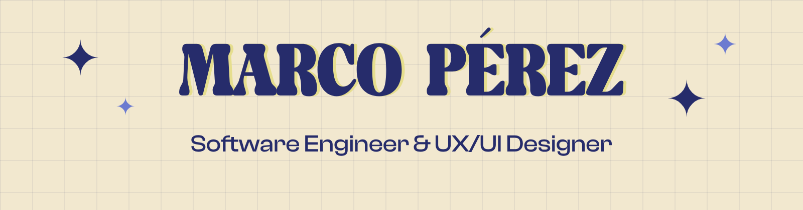
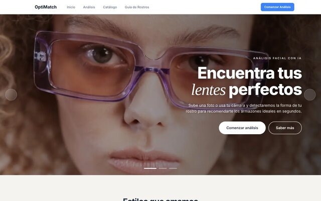
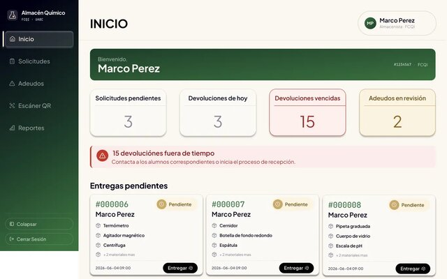

  

  
  
  

Soy estudiante de **Ingeniería en Software y Tecnologías Emergentes** en la UABC (egreso en 2027). Trabajo en diseño UX/UI y desarrollo web: hago investigación de usuario, diseño interfaces en Figma y las implemento con HTML, CSS, JavaScript y Python. Entre mis proyectos están [OptiMatch](https://marquitosph.github.io/portafolio/proyectos/optimatch.html), una app web que recomienda lentes según la forma del rostro con un modelo de IA que entrené, y el rediseño del sistema de préstamos del Almacén de Química de mi facultad. Tengo las certificaciones de Google UX Design y AWS Academy Cloud Architecting.

### Actualmente estoy aprendiendo
- Kotlin y desarrollo de apps Android
- React y Angular

### Estoy trabajando en
- [Rediseño del sistema de préstamos del Almacén Químico](https://marquitosph.github.io/portafolio/proyectos/almacen-quimico.html) de la FCQI, UABC

 

## Con qué trabajo

**Código**

**Diseño**

## Proyectos

<table>
  <tr>
    <td width="50%" valign="top">
      
      <h3>OptiMatch</h3>
      
App web que detecta la forma de tu rostro con IA y recomienda los lentes que mejor te quedan.

      
<code>Python</code> <code>FastAPI</code> <code>ONNX</code>

      
<a href="https://marquitosph.github.io/portafolio/proyectos/optimatch.html">Caso de estudio</a> · <a href="https://github.com/MarquitosPH/face-recognition-mediapipe">Código</a>

    </td>
    <td width="50%" valign="top">
      
      <h3>Almacén Químico</h3>
      
Rediseño UX/UI del sistema de préstamos de laboratorio de la FCQI: auditoría, design system y todas las vistas.

      
<code>Figma</code> <code>Design System</code>

      
<a href="https://marquitosph.github.io/portafolio/proyectos/almacen-quimico.html">Caso de estudio</a>

    </td>
  </tr>
</table>

También: [PlaylistScript](https://github.com/MarquitosPH/PlaylistScript), un lenguaje de scripting en Java para generar playlists de Spotify.

## Certificaciones

- **Google UX Design** · Coursera
- **Web Design for Everybody** (especialización) · University of Michigan · [verificar](https://coursera.org/verify/specialization/621QODHDD6CH)
- **AWS Academy Graduate – Cloud Architecting** · [verificar](https://www.credly.com/go/k6JNwCcf)
